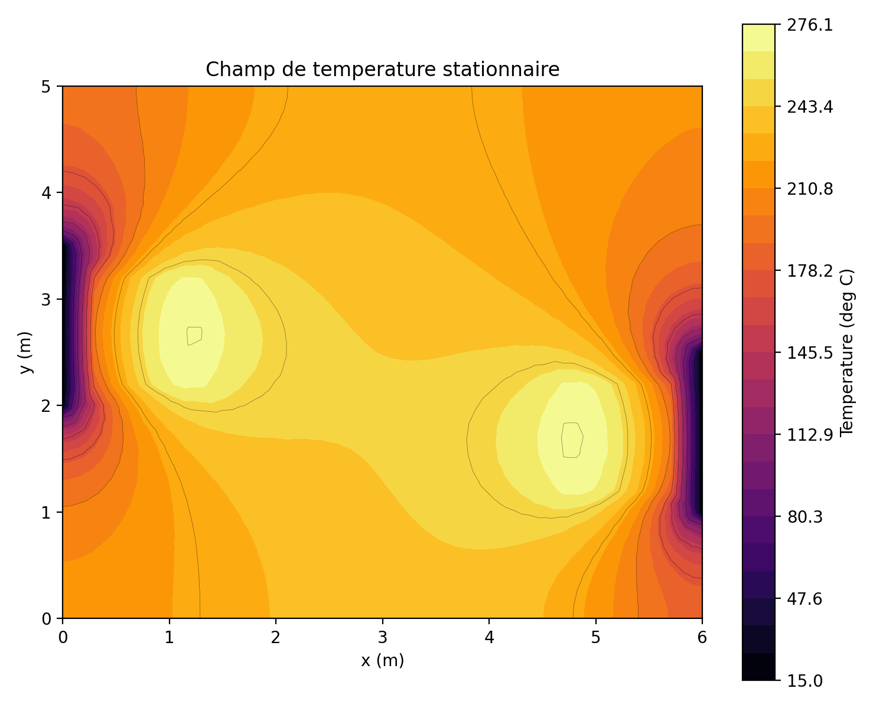
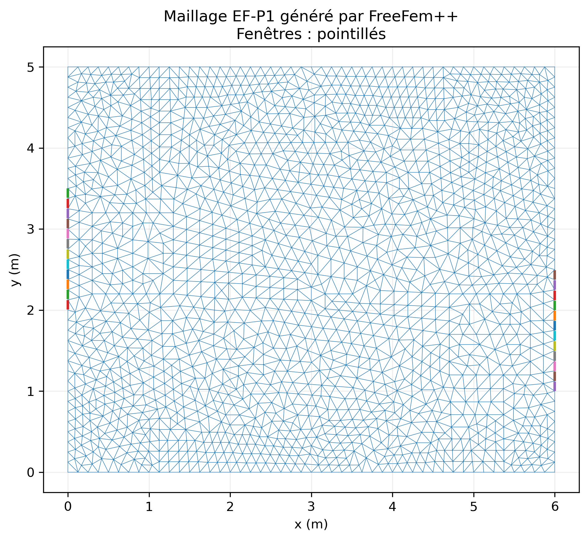
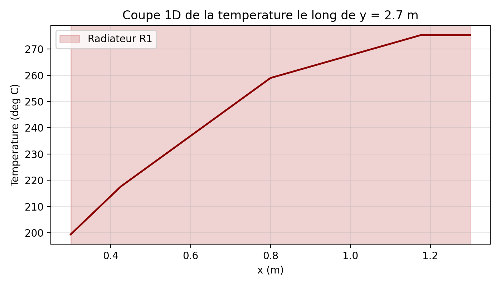

# Modélisation et simulation thermique d'une habitation

## 1. Présentation du projet

Ce projet tutoré, réalisé dans le cadre de la Licence 3 Mathématiques et Modélisation à l'Université Amadou Mahtar Mbow (UAM), porte sur la modélisation mathématique et la simulation numérique du chauffage d'une habitation.

L'étude repose sur la résolution numérique d'un problème de diffusion thermique en deux dimensions, en utilisant la méthode des éléments finis P1.

Le projet met en œuvre des outils de calcul scientifique, notamment FreeFem++ et Python, pour construire le maillage, assembler les systèmes numériques et visualiser les champs de température.

## 2. Objectifs

Les principaux objectifs sont :

- Modéliser mathématiquement le transfert thermique dans une habitation.
- Construire un domaine géométrique représentant une habitation avec des fenêtres et des zones de chauffage.
- Discrétiser le domaine à l'aide d'un maillage triangulaire.
- Mettre en œuvre la méthode des éléments finis P1.
- Résoudre numériquement le problème thermique.
- Étudier et visualiser la distribution de température dans le domaine.

## 3. Géométrie et maillage

Le domaine étudié représente une habitation de dimensions :

- Longueur : 6 m.
- Largeur : 5 m.

La géométrie comprend deux fenêtres et deux zones représentant les radiateurs.

Le maillage est constitué de triangles et est construit à l'aide de FreeFem++.

Une représentation du maillage est disponible dans les figures du projet.

## 4. Modélisation mathématique

Le problème thermique stationnaire étudié repose sur l'équation de diffusion :

\[
-\nabla\cdot(\lambda\nabla u)=f
\quad \text{dans }\Omega.
\]

Où :

- \(\Omega\) désigne le domaine de l'habitation.
- \(u\) représente le champ de température.
- \(\lambda\) désigne le coefficient de diffusion thermique.
- \(f\) représente le terme source associé aux zones de chauffage.

Le coefficient de diffusion est défini suivant les régions du domaine :

| Région | Coefficient |
|---|---:|
| Air | 0,25 |
| Radiateurs | 1,0 |

Le terme source thermique utilisé dans les zones des radiateurs est fixé à 50 dans le modèle de référence.

### Conditions aux limites

Le modèle de référence utilise :

- **Condition de Neumann homogène :** flux normal nul sur les murs isolants.
- **Condition de Dirichlet :** température imposée à 15 °C sur les fenêtres.

Une variante numérique étudiée dans le projet introduit également un terme de flux de Neumann non homogène sur une frontière identifiée par le label 3.

## 5. Méthode numérique : éléments finis P1

La résolution numérique repose sur la méthode des éléments finis P1.

Le domaine est discrétisé en éléments triangulaires. Sur chaque triangle, la température est approximée par une fonction affine.

La formulation faible du problème de référence s'écrit :

$$
\int_{\Omega} \lambda \nabla u \cdot \nabla v\, d\Omega
=
\int_{\Omega} f v\, d\Omega.
$$

Les conditions aux limites sont ensuite intégrées dans la formulation numérique.
Cette approche permet de transformer le problème continu en un système algébrique dont la résolution fournit une approximation du champ de température.

## 6. Implémentation informatique

### FreeFem++

FreeFem++ est utilisé pour :

- Définir la géométrie de l'habitation.
- Construire le maillage triangulaire.
- Définir les espaces d'éléments finis P1.
- Formuler et résoudre le problème thermique.
- Visualiser les résultats numériques.

### Python

Python est utilisé pour :

- Lire les fichiers de maillage produits par FreeFem++.
- Identifier les sommets, triangles et régions.
- Construire les matrices élémentaires et globales dans l'implémentation Python.
- Exploiter les résultats numériques.
- Produire des représentations graphiques.

Les bibliothèques utilisées comprennent notamment NumPy, SciPy et Matplotlib.

## 7. Résultats et visualisations

Le dépôt contient plusieurs illustrations issues des différentes étapes du travail :

- Maillage triangulaire de l'habitation.
- Distribution spatiale de la température.
- Représentation du champ de température.
- Coupe unidimensionnelle.
- Figures relatives aux résultats numériques.
- Données numériques exportées pour leur exploitation.

### Quelques illustrations

**Champ de température**

**Maillage par éléments finis P1**

**Coupe unidimensionnelle**

## 8. Organisation du dépôt

- `chauffage.edp` : construction du maillage et résolution de référence avec FreeFem++.
- `etape5_maillage.edp` : script associé à la construction du maillage de l'étape 5.
- `etape6_option3.edp` : variante de résolution sous FreeFem++.
- `chauffage.py` : implémentation Python de la résolution thermique.
- `chauffage_etape5.py` : implémentation Python de l'étape 5.
- `habitation.mesh` et `habitation_etape5.mesh` : fichiers de maillage.
- `temperature.txt` et `temperature_etape5.txt` : données numériques de température.
- `figures/` : visualisations et données issues des simulations.

## 9. Outils utilisés

- FreeFem++ : calcul par éléments finis.
- Python : implémentation et exploitation numérique.
- NumPy : calcul matriciel.
- SciPy : calcul scientifique.
- Matplotlib : visualisation graphique.
- LaTeX : rédaction du rapport scientifique.
- Git et GitHub : gestion et partage du code source.

## 10. Cadre académique

- **Établissement :** Université Amadou Mahtar Mbow (UAM).
- **Formation :** Licence 3 Mathématiques et Modélisation.
- **Type de travail :** Projet tutoré.
- **Encadrant :** M. Diop.
- **Auteur :** Papa Kady BA.

## 11. Perspectives

Ce travail peut être prolongé par :

- L'étude de problèmes thermiques dépendant du temps.
- L'amélioration du maillage et l'étude de la convergence numérique.
- L'analyse comparative des différentes approches de résolution.
- L'intégration de paramètres physiques supplémentaires.

---

*Projet académique en mathématiques appliquées, analyse numérique et calcul scientifique.*
